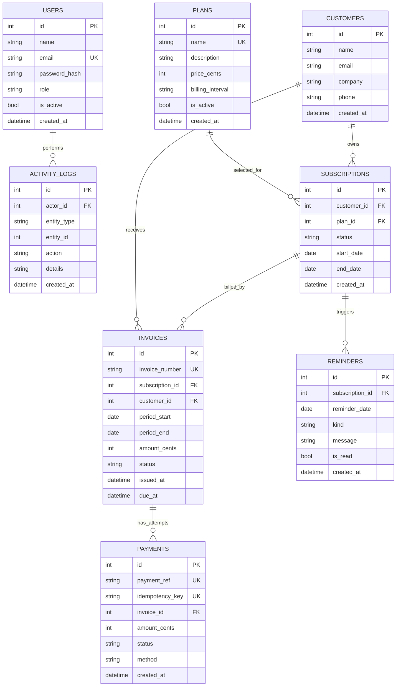

# Database ER diagram

## Important constraints

- User email is unique.
- Plan name is unique.
- Invoice number is unique.
- A subscription cannot have more than one invoice for the same `period_start`.
- Payment reference and non-null idempotency key are unique.
- Money is stored as integer cents to avoid floating-point rounding errors.
